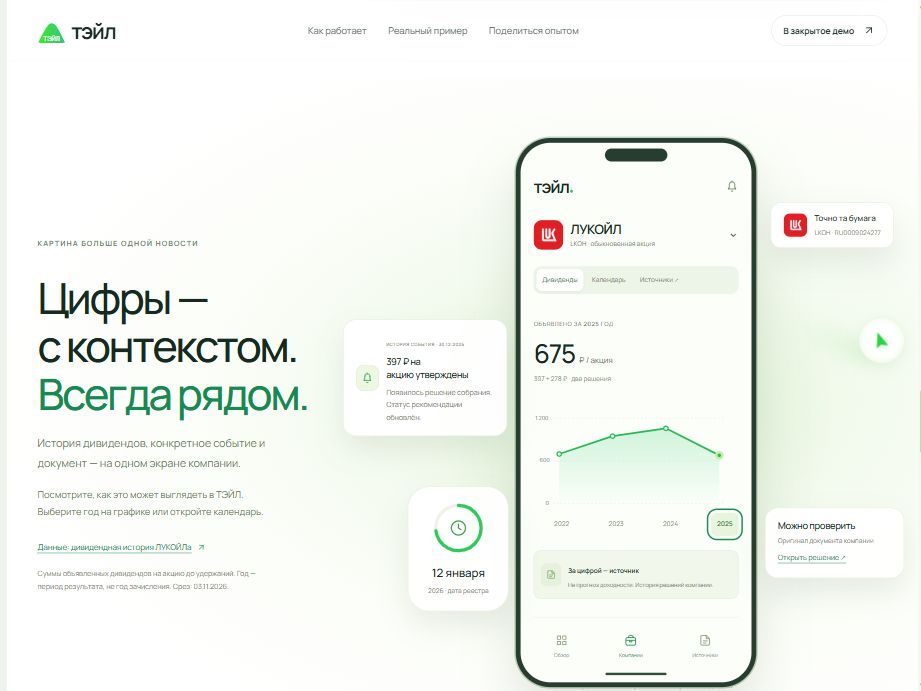
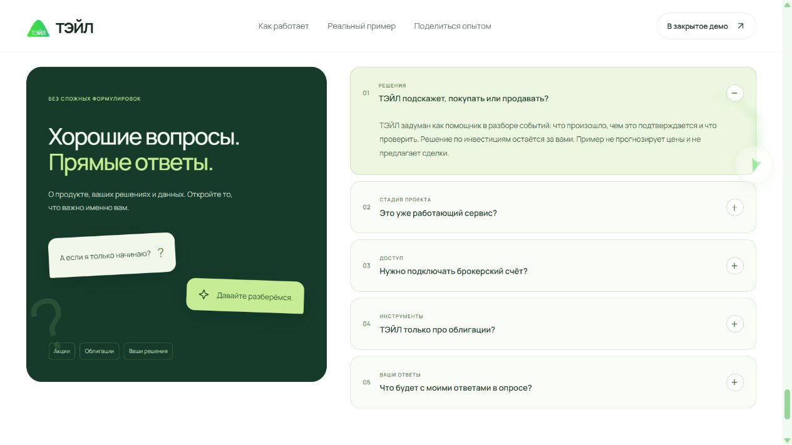

# ТЭЙЛ — лендинг

**Посмотреть сайт без скачивания:** [публичное демо ТЭЙЛ](https://tail-invest.fivers2b.chatgpt.site/). В опубликованном демо ответы анкеты не отправляются; рабочий сервер с SQLite можно запустить локально по инструкции ниже.

Лендинг ТЭЙЛ с реальным историческим кейсом ЛУКОЙЛа и исследовательским опросом. Это самостоятельный репозиторий, отдельный от Tail Middle и Tail Junior. Первоначальный код восстановлен по публичному сайту <http://192.144.14.178/> по поручению владельца от 3 ноября 2026 года; затем главная страница переработана по обсуждённому направлению.


Первый экран начинается с «Меньше догадок. Больше контроля над инвестициями» и ведёт в реальный пример. На широком высоком экране прокрутка раскрывает четыре сцены: рекомендация по LKOH → разбор → документ → решение собрания. Указатель в макете показывает ход демонстрации. На мобильном и при `prefers-reduced-motion` доступны кнопки шагов без закрепления секции.

В новой версии есть экран компании с графиком дивидендов ЛУКОЙЛа за 2016–2025 годы, календарь, появляющиеся карточки событий, цветная лента логотипов и биржевой маркер прогресса в поле страницы. Число компаний в индексе посчитано по уникальным эмитентам: 41 компания / 44 бумаги на 02.11.2026. Подпись охвата обозначает план продукта; автоматический мониторинг не заявляется как запущенный.



Источники и метод подсчёта: [docs/market-evidence](docs/market-evidence/README.md), [кейс ЛУКОЙЛа](docs/market-evidence/LUKOIL.md). Новые ресурсы: `public/market.css`, `market-experience.js`, `market-data.js`, `company-logos/`. Версия анкеты — 4, с названиями реальных состояний события вместо прежних вымышленных сценариев.

## Запуск на этом ПК

Скачать проект: [ZIP с текущим кодом](https://github.com/ivanfix2005/tail-landing/archive/refs/heads/main.zip). Порядок совместной работы и отправки изменений: [CONTRIBUTING.md](CONTRIBUTING.md).

Нужен **Node.js 24 или новее**. Для запуска готовой версии устанавливать npm-зависимости не нужно: сервер использует стандартные модули Node.js, собранные UI-ресурсы включены в репозиторий.

Дважды нажмите `start-tail-landing.cmd` или выполните из папки проекта:

```sh
npm start
```

Если npm недоступен в командной строке, используйте `node server/index.mjs` или файл запуска: он также находит Node.js, поставляемый с Codex на этом ПК.

Откройте **http://127.0.0.1:8790/**. Остановка — `Ctrl+C`. Для разработки: `npm run dev`; после правки HTML/CSS/JS обновите вкладку.

При необходимости скопируйте `.env.example` в `.env`: порт, путь к базе и необязательный счётчик Метрики задаются там. По умолчанию сервер доступен только на этом компьютере, аналитика выключена. Запуск `index.html` двойным щелчком не заменяет HTTP-сервер: опросу нужен API.

## Где править

| Файл | Содержание |
| --- | --- |
| `public/index.html` | Главная страница: шапка, первый экран, преимущества, демо, FAQ и подвал |
| `public/styles.css` | Оформление, адаптивность, анимация заголовка и ленты |
| `public/content.js` | Три демо-сценария, вопросы и варианты ответов опроса |
| `public/app.js` | Переключение демо, шаги опроса, собственные ответы и отправка |
| `public/survey-model.js` | Общая для браузера и сервера проверка опроса |
| `public/analytics.js` | Согласие на аналитику, квитанции и необязательная Метрика |
| `public/privacy/`, `public/consent/` | Три правовые страницы |
| `server/` | HTTP-сервер, API и SQLite-хранилище |

Главная страница теперь имеет новую композицию, тексты, локальные макеты интерфейса и анимации. `public/landing.css` и `public/landing-motion.js` отвечают за новую страницу; общий `styles.css` также используется правовыми страницами и формой. GSAP и ScrollTrigger 3.15.0 поставляются локально в `public/vendor/`, без запросов к CDN; происхождение и лицензия указаны в `docs/THIRD_PARTY.md`. Для хранения новых ответов используется встроенная SQLite. Скрытый код исходного сервера, его настройки, ключи и ранее собранные ответы не восстановлены и не перенесены.

## Анимации и сборка иллюстраций

Контрастный разбор, интерактивный пример, опрос и FAQ оформлены в public/refined.css и public/interactive.css. Модуль public/journey-motion.js ведёт декоративный значок по странице, public/interaction-motion.js отвечает за короткие реакции настоящих элементов управления. Клавиатура и reduced motion получают моментальные переключения.

Актуально на 5 ноября: прежний фон с кольцами и наклонными плашками возвращён по пожеланию владельца. Телефон шириной 280 px по-прежнему вписывается в высоту окна ПК, у четырёх сцен сохранены увеличенная дистанция прокрутки и интервалы чтения. Каждый пройденный шаг анкеты запускает рождение свечи, следующий вопрос сохраняет положение экрана. Заголовок приглашает находить возможности для большего дохода, без гарантии прибыли. Макеты будущих функций явно отделены от реального кейса ЛУКОЙЛа. Публичное демо завершает анкету локально. Сборщик версионирует CSS и весь граф ES-модулей. Детали: [ATMOSPHERE](docs/ATMOSPHERE.md), [MARGINS_AND_PACING](docs/MARGINS_AND_PACING.md), [PRODUCT_STRUCTURE](docs/PRODUCT_STRUCTURE.md).

Цветные фоны и боковые сегменты находятся в public/atmosphere.css и public/atmosphere.js. Пластины, кольца и полосы появляются при прокрутке; невидимые группы и скрытая вкладка не продолжают движение. На телефоне композиция компактнее, постоянное движение отключено. Проверки и ограничения: [ATMOSPHERE](docs/ATMOSPHERE.md).

Блок возможностей полностью заменён широким рабочим столом: одна компания переходит из портфеля в отчёт, событие и основание ответа. Можно соединить доли одного бизнеса, переключить показатель, открыть купон в календаре и проверить расчёт. Медленная прокрутка и паузы для чтения сохранены. Детали: [WORKSPACE_DESK](docs/WORKSPACE_DESK.md).

Новые миниатюры преимуществ используют React и Stageshow только внутри #benefits-island. Исходники — ui/benefits.tsx и ui/benefits.css. После их изменения: npm ci --ignore-scripts, затем npm run build:ui; в коммит включаются оба результата в public/components/. Зависимости сборки закреплены; сервер и файл запуска Windows не требуют npm install. Происхождение и лицензии: ui/README.md и docs/THIRD_PARTY.md.

В опросе появилась навигация по темам, в FAQ — карточки и измеряемое раскрытие. Формулировки вопросов, проверка согласия, ветвление и SQLite сохранены. Подробный проход и ограничения проверки: [REHEARSAL](docs/stageshow-refinement/REHEARSAL.md).



## Опрос и данные

Работают все три демо, раскрытие источников, ветвление опроса на 4 или 5 шагов, собственные ответы, возврат назад, обязательное согласие, отправка, квитанция и блок бета-тестирования после успешного сохранения. Сервер повторно проверяет ответы; повтор одной отправки не создаёт дубликат. Ошибки и тайм-ауты показываются в форме, ответы остаются доступными для повторной отправки.

Новая база создаётся автоматически в `data/tail.sqlite`. Она, `.env`, журналы и выгрузки исключены из Git. Открытого API для чтения ответов нет. Выгрузка на компьютере владельца:

```sh
node --env-file-if-exists=.env scripts/export-surveys.mjs > answers.json
```

Не добавляйте выгрузки в репозиторий. Данные опроса очищаются после 12 месяцев, минимальные квитанции согласий — после 3 лет; проверка выполняется при запуске и каждый час. Для резервной копии работающей SQLite используйте штатный SQLite backup или копируйте базу после остановки сервера вместе с файлами WAL, если они остались.

Метрика включается только при заданном `METRIKA_COUNTER_ID` и отдельном согласии. Ответы, суммы и ID опроса не включаются в события аналитики. Настройки cookie доступны в подвале. Старый счётчик намеренно не переносился в настройки нового проекта.

## Проверка

```sh
npm run check
npm test
```

Без npm: `node scripts/check.mjs` и `node --test tests/server.test.mjs`.

Проверяются четыре страницы и ресурсы, сохранение и чтение SQLite после нового подключения, повторная отправка, конфликты ID, ветки опроса, обязательное согласие, ограничения запросов, закрытость базы, срок хранения и квитанции аналитики.

## Развёртывание

Публичная демонстрация публикуется отдельно без сбора ответов. Рабочая версия с Node.js и SQLite остаётся доступной для локального запуска. Для статического демо: `node scripts/build-demo.mjs .runtime/my-demo` (выберите ещё не существующую папку). Скрипт отключает API и Метрику, заменяет отправку завершением демонстрации и добавляет заметные пояснения. Не публикуйте обычную папку public на статическом хостинге с неработающей отправкой.

Для настоящего сбора ответов требуется отдельное размещение сервера и базы в РФ. Подготовленная конфигурация Amvera и инструкция: [DEPLOYMENT_RU](docs/DEPLOYMENT_RU.md). Платный ресурс не создан.

```sh
docker compose up -d --build
```

Приложение доступно на loopback-порту 8790, данные сохраняются в отдельном томе `tail-data`. Для домена подключите свой обратный прокси с HTTPS и задайте `PUBLIC_ORIGIN` равным внешнему origin, например `https://example.ru`. Приложение не доверяет произвольным заголовкам `X-Forwarded-*`. Встроенное ограничение частоты считает адрес соединения, поэтому за прокси дополнительно настройте ограничения на нём.

Этот проект сам по себе не заменяет сайт на старом сервере. Для такой замены требуется отдельное развёртывание с доступом к хостингу. Перед запуском на другом адресе согласуйте реквизиты оператора, адрес сайта и фактическую инфраструктуру в скопированных правовых страницах.

Происхождение ресурсов и границы восстановления: [docs/RESTORATION.md](docs/RESTORATION.md).
