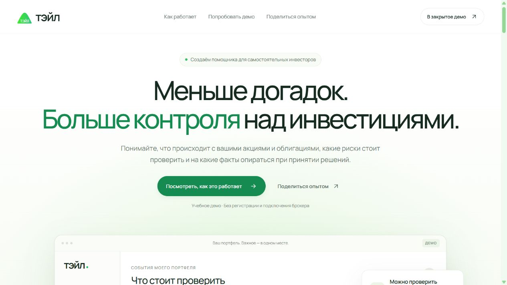

# ТЭЙЛ — лендинг

Лендинг ТЭЙЛ с учебным разбором событий по инвестициям и исследовательским опросом. Это самостоятельный репозиторий, отдельный от Tail Middle и Tail Junior. Первоначальный код восстановлен по публичному сайту <http://192.144.14.178/> по поручению владельца от 3 ноября 2026 года; затем главная страница переработана по обсуждённому направлению.



Первый экран начинается с «Меньше догадок. Больше контроля над инвестициями» и ведёт в учебный пример. На широком высоком экране прокрутка раскрывает четыре сцены: событие по бумаге → разбор → первоисточник → история изменений. Указатель в макете показывает ход демонстрации. На мобильном и при `prefers-reduced-motion` доступны кнопки шагов без закрепления секции.

## Запуск на этом ПК

Нужен **Node.js 24 или новее**. Внешних npm-зависимостей нет.

Дважды нажмите `start-tail-landing.cmd` или выполните из папки проекта:

```sh
npm start
```

Если npm недоступен в командной строке, используйте `node server/index.mjs` или файл запуска: он также находит Node.js, поставляемый с Codex на этом ПК.

Откройте **http://127.0.0.1:8790/**. Остановка — `Ctrl+C`. Для разработки: `npm run dev`; после правки HTML/CSS/JS обновите вкладку.

При необходимости скопируйте `.env.example` в `.env`: порт, путь к базе и необязательный счётчик Метрики задаются там. По умолчанию сервер доступен только на этом компьютере, аналитика выключена. Запуск `index.html` двойным щелчком не заменяет HTTP-сервер: опросу нужен API.

## Где править

| Файл | Содержание |
| --- | --- |
| `public/index.html` | Главная страница: шапка, первый экран, преимущества, демо, FAQ и подвал |
| `public/styles.css` | Оформление, адаптивность, анимация заголовка и ленты |
| `public/content.js` | Три демо-сценария, вопросы и варианты ответов опроса |
| `public/app.js` | Переключение демо, шаги опроса, собственные ответы и отправка |
| `public/survey-model.js` | Общая для браузера и сервера проверка опроса |
| `public/analytics.js` | Согласие на аналитику, квитанции и необязательная Метрика |
| `public/privacy/`, `public/consent/` | Три правовые страницы |
| `server/` | HTTP-сервер, API и SQLite-хранилище |

Главная страница теперь имеет новую композицию, тексты, локальные макеты интерфейса и анимации. `public/landing.css` и `public/landing-motion.js` отвечают за новую страницу; общий `styles.css` также используется правовыми страницами и формой. GSAP и ScrollTrigger 3.15.0 поставляются локально в `public/vendor/`, без запросов к CDN; происхождение и лицензия указаны в `docs/THIRD_PARTY.md`. Для хранения новых ответов используется встроенная SQLite. Скрытый код исходного сервера, его настройки, ключи и ранее собранные ответы не восстановлены и не перенесены.

## Опрос и данные

Работают все три демо, раскрытие источников, ветвление опроса на 4 или 5 шагов, собственные ответы, возврат назад, обязательное согласие, отправка, квитанция и блок бета-тестирования после успешного сохранения. Сервер повторно проверяет ответы; повтор одной отправки не создаёт дубликат. Ошибки и тайм-ауты показываются в форме, ответы остаются доступными для повторной отправки.

Новая база создаётся автоматически в `data/tail.sqlite`. Она, `.env`, журналы и выгрузки исключены из Git. Открытого API для чтения ответов нет. Выгрузка на компьютере владельца:

```sh
node --env-file-if-exists=.env scripts/export-surveys.mjs > answers.json
```

Не добавляйте выгрузки в репозиторий. Данные опроса очищаются после 12 месяцев, минимальные квитанции согласий — после 3 лет; проверка выполняется при запуске и каждый час. Для резервной копии работающей SQLite используйте штатный SQLite backup или копируйте базу после остановки сервера вместе с файлами WAL, если они остались.

Метрика включается только при заданном `METRIKA_COUNTER_ID` и отдельном согласии. Ответы, суммы и ID опроса не включаются в события аналитики. Настройки cookie доступны в подвале. Старый счётчик намеренно не переносился в настройки нового проекта.

## Проверка

```sh
npm run check
npm test
```

Без npm: `node scripts/check.mjs` и `node --test tests/server.test.mjs`.

Проверяются четыре страницы и ресурсы, сохранение и чтение SQLite после нового подключения, повторная отправка, конфликты ID, ветки опроса, обязательное согласие, ограничения запросов, закрытость базы, срок хранения и квитанции аналитики.

## Развёртывание

```sh
docker compose up -d --build
```

Приложение доступно на loopback-порту 8790, данные сохраняются в отдельном томе `tail-data`. Для домена подключите свой обратный прокси с HTTPS и задайте `PUBLIC_ORIGIN` равным внешнему origin, например `https://example.ru`. Приложение не доверяет произвольным заголовкам `X-Forwarded-*`. Встроенное ограничение частоты считает адрес соединения, поэтому за прокси дополнительно настройте ограничения на нём.

Этот проект сам по себе не заменяет сайт на старом сервере. Для такой замены требуется отдельное развёртывание с доступом к хостингу. Перед запуском на другом адресе согласуйте реквизиты оператора, адрес сайта и фактическую инфраструктуру в скопированных правовых страницах.

Происхождение ресурсов и границы восстановления: [docs/RESTORATION.md](docs/RESTORATION.md).
